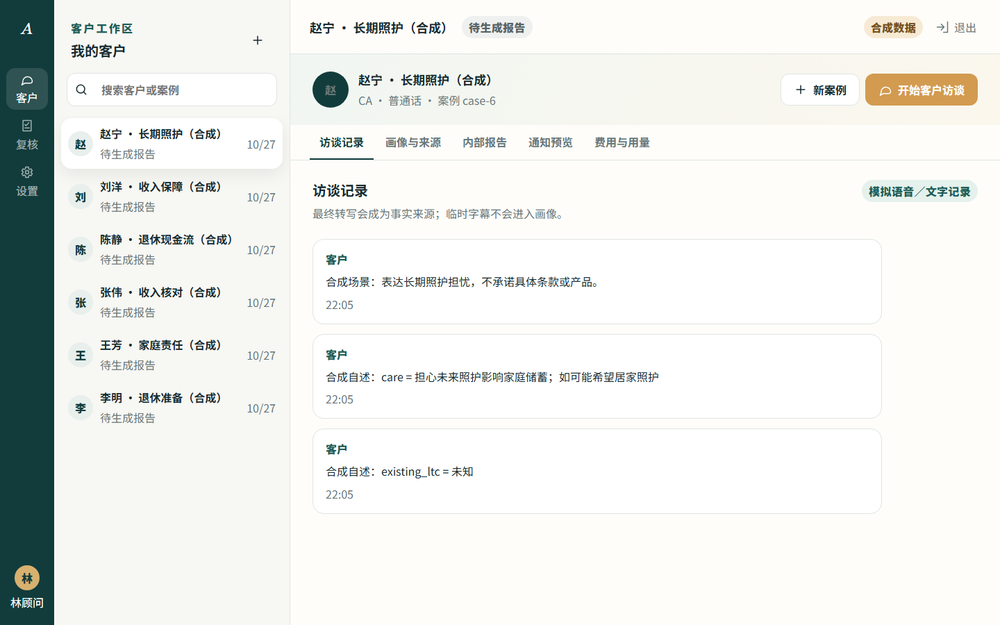

# Aeconn AI Agent · 顾问访谈 Demo

面向 Aeconn 真人保险顾问的中文本地 Demo：建立合成客户档案 → 受限客户访谈 → 结束并交还手机 → 内部报告与中文 PDF → 顾问确认两份邮件预览 → Charles 复核。

实现依据：[Notion「02｜可直接复制给 Codex 的开发 Prompt」V1.3](https://app.notion.com/p/406d9731c2408174a24dfa30ff68ee52)。这是合成数据开发检查点，不是获准处理真实客户资料的生产系统。当前分析回复和语音选择器都默认 `mock`，邮件默认 dry-run；这不代表 Charles 首版已就绪。Charles 首版必须接入真实 AI 与真实连续语音，并在目标手机验收。

项目文档：[产品需求 PRD](PRD.md) · [MVP 范围与交付状态](mvp.md) · [逐项验收账本](docs/acceptance.md) · [工程验证记录](docs/verification.md)



[查看 390×844 客户助手截图](docs/screenshots/client-mobile-390x844.png)

## 启动

需要 **Node.js 24.x** 和 Git。依赖版本由 `package-lock.json` 锁定。当前原型不需要 API 密钥、本地模型、独立显卡、模型权重、Docker 或额外数据库服务。

Windows PowerShell：

```powershell
git clone https://github.com/ovo0809/AconGlobalBot.git
Set-Location AconGlobalBot
Copy-Item .env.example .env.local
npm ci
npm run dev
```

macOS / Linux：

```bash
git clone https://github.com/ovo0809/AconGlobalBot.git
cd AconGlobalBot
cp .env.example .env.local
npm ci
npm run dev
```

打开 **http://127.0.0.1:3000**。首次访问自动建立 SQLite schema v2 和 12 个合成案例；已有数据库增量迁移。

生产模式本地验证：`npm run build` 后运行 `npm start`。自定义 Node 服务同时承载 Next.js 页面、API、SQLite 和语音 WebSocket；不能用 GitHub Pages 承载这些服务。

## 演示账号

| 身份 | 邮箱 | 权限 |
| --- | --- | --- |
| 林顾问 | advisor1@aeconn.example | 仅本人客户与案例 |
| 陈顾问 | advisor2@aeconn.example | 与林顾问数据隔离 |
| Charles | charles@aeconn.example | 仅已交给他的案例 |
| 管理员 | admin@aeconn.example | 账号邮箱及配置，无业务资料权限 |

本地演示密码均为 `AeconnDemo!2026`，可在**首次建库前**用 `DEMO_PASSWORD` 替换。更改环境变量不会修改已存在账号的密码。所有 `.example` / `.invalid` 邮箱为占位，不发送邮件。不要在公开服务器使用这些默认账号密码。

## 跑通一次完整流程

1. 以顾问登录，点击新建客户，填写姓名、生日、性别、电话、邮箱、婚姻状态六项合成资料，并说明采集用途。
2. 开始客户访谈。此时服务端将同一设备会话改为受限模式，原顾问 cookie 也无法读取客户列表、报告、收件人或复核接口。
3. 选择人寿、伤残保险、年金或长期护理。入口只影响提问顺序；每个报告均检查四类需求。
4. 缺少实时服务配置时使用 mock／文字回答。文字与语音共用同一访谈上下文和下一问逻辑；财务金额请明确币种及月／年／一次性周期，可以回答“不知道”或“不愿提供”。暂停后必须主动恢复。
5. 点击结束，停止音频并返回原顾问当前案例，无 PIN。页面提示交还手机，系统无法判断持机人是否已经更换；报告任务写入 SQLite 后由同一 Node 进程后台运行，报告不自动展开或朗读。
6. 明确打开内部报告，核对事实与来源。修正事实需理由，会创建新报告版本；历史版本与 PDF 保留。
7. 邮件预览显示公司和归属顾问两份完整正文及同版本 PDF。点击确认只创建两份 **未发送** dry-run 记录；取消只保存报告。客户邮箱不接收报告。
8. 提交 Charles 复核，然后以 Charles 登录。确认、退回补问、修改意见与进入现有报价流程均需理由，保留复核版本；系统不报价。

## 功能状态

| 功能 | 状态 |
| --- | --- |
| 服务端会话、CSRF、顾问隔离、管理员隔离、客户模式限制 | 已实现并自动测试 |
| 六字段建档、12 个合成场景、文字访谈、未知／拒答、事实来源 | 共享上下文、严格来源与金额校验已有自动测试；真实 AI 质量未验收 |
| 四类别规则、六块报告、中文分页 PDF、版本与复核 | 已实现；规则标记 `demo_unapproved`，未做业务正确率验收 |
| 模型访谈与分析 | 默认仍为 `mock`；OpenAI 模型列表认证请求 HTTP 200，项目真实访谈请求因余额不足返回 HTTP 429，未得到 AI 回复或事实 |
| 连续语音 | 默认 `VOICE_PROVIDER=mock`；OpenAI Realtime／Gemini Live 适配器保留，真实服务与手机均未验收 |
| 报告任务 | SQLite 后台任务、自动生成、失败重试及重启恢复已通过工程测试；报告只读取保存事实 |
| 邮件 | 完整 dry-run 正文／PDF 已实现；真实传输接口有策略保护，但未配置真实发送服务 |
| 备份／恢复 | SQLite online backup，包含数据库内 PDF 与版本，自动测试通过 |

详细证据与限制见 [验证记录](docs/verification.md)、[决策记录](decisions.md)、[模型及语音配置](docs/providers.md)、[PDF 验证](docs/report-validation.md)。

## OpenAI 验证状态

当前开发检查点保持下面两项默认值，即使系统环境中已有云端密钥也不会自动调用网络：

```dotenv
LLM_PROVIDER=mock
VOICE_PROVIDER=mock
```

用户已选择 OpenAI 作为下一阶段主验证服务。安全密钥已经写入 Git 忽略的本机 `.env.local`；不要上传 GitHub，也不要把密钥粘贴到聊天记录。当前本机模型配置为：

```dotenv
LLM_PROVIDER=openai
VOICE_PROVIDER=openai
OPENAI_API_KEY=<仅存在于本机环境>
OPENAI_MODEL=gpt-6-luna
OPENAI_REALTIME_MODEL=gpt-realtime-2.1
```

2026-10-27 21:01:44（America/Los_Angeles；UTC 2026-10-28 04:01:44）真实请求 `GET /v1/models` 返回 HTTP 200，证明当前凭证可通过认证，列表中可见 `gpt-6-luna` 和 `gpt-realtime-2.1`。模型出现在列表中不代表该项目具有推理额度，也不代表文字或实时能力已验收。

2026-10-28 04:02:54Z，项目真实 `interviewWithProvider` 使用 `gpt-6-luna` 和一句合成客户输入调用 OpenAI Responses API；请求返回 HTTP 429，错误为 `credit_balance_exhausted`／`insufficient_quota`。没有收到 AI 回复，也没有提取事实。下一步需为对应 API 账户补充可用余额／额度后重试同一合成探针，再分别验证完整访谈、后台报告、实时音频和目标手机。Gemini 配置仍作为可选 Provider 保留，选择器允许 `mock|openai|gemini`。

只有 Provider 选择器与所需配置同时满足时，云端能力才启用；文字模型和连续语音可以分别验证。姓名、电话、邮箱和完整生日等建档字段不直接提交给分析模型；用户在自由文本内主动透露的身份信息不能保证完全自动去除，因此仍只使用合成资料。

InterviewAgent 只产生客户可见回复和带严格来源的候选事实，报告 Provider 只产生四类分析。权限、案例归属、状态、收件人、发送批准和人工确认仍由业务层控制。未来如有离线或成本需求，可以在同一边界新增 Ollama Provider；当前没有实现、安装或自动拉取 Ollama 模型，也不保证只替换 URL 就能获得同等质量、延迟或连续语音能力。

手机测试需受信任 HTTPS，电脑 localhost 能录音不代表手机通过局域网 HTTP 能录音。默认只监听回环地址。受控测试步骤见 [迁移与 HTTPS](docs/operations.md)；不应直接将默认 Demo 暴露到互联网。

## 检查与维护

```bash
npm run typecheck
npm run lint
npm test
npm run build
npx playwright install chromium
npm run test:e2e
```

GitHub Actions 会重复运行这些检查及 Chromium 浏览器测试。`.env*`、SQLite 文件、日志、测试数据库和输出目录均被 Git 忽略。

```bash
npm run backup -- ./data/backups/manual.sqlite
npm run restore -- ./data/backups/manual.sqlite ./data/restored.sqlite
```

恢复不覆盖原数据库。停止旧服务后，将 `.env.local` 的 `DATABASE_PATH` 改为新的数据库文件，再启动并核对案例、版本和权限。迁移到新电脑必须重新执行 `npm ci`，不要复制 `node_modules`。详见 [运维说明](docs/operations.md)。

## 代码结构

- `app/`：响应式界面和服务端 API。
- `lib/service.ts` / `lib/db.ts`：权限、状态机、来源、SQLite schema、后台报告任务、批准与 Outbox。
- `lib/interview.ts`：共享访谈上下文、下一问、严格 JSON 与事实来源校验。
- `lib/report.ts` / `lib/scenarios.ts`：独立示范规则、合成数据、报告和 PDF。
- `lib/provider-config.ts` / `lib/providers.ts`：集中选择 Provider，隔离 Mock／OpenAI／Gemini 实现与业务逻辑。
- `lib/voice-server.ts` / `lib/browser-voice.ts`：实时语音的服务端中继与浏览器边界。
- `lib/mail.ts`：预览、发送策略、accepted/delivered/unknown 边界及对账流程。
- `scripts/`、`tests/`、`.github/workflows/`：备份恢复、自动验证、CI。

中文 PDF 字体为 Noto Sans CJK SC，遵循随附 SIL Open Font License；见 `public/fonts/OFL.txt`。
